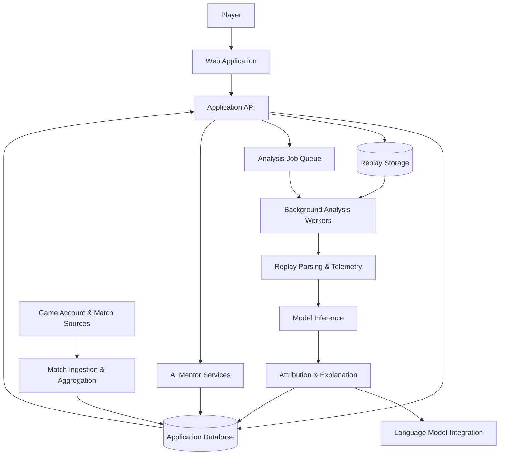
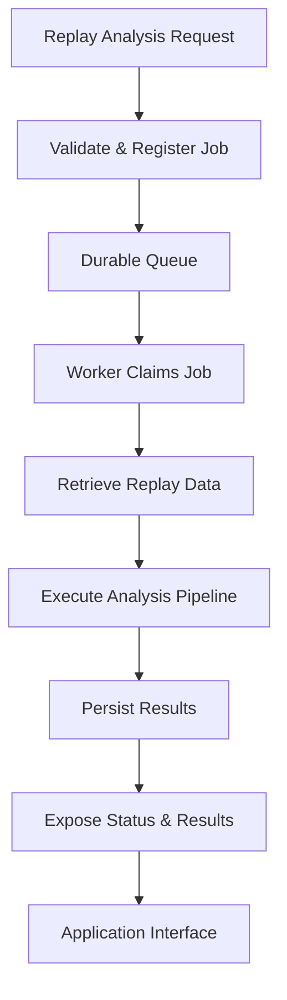
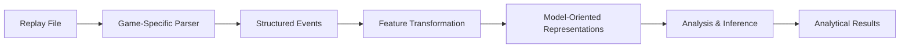
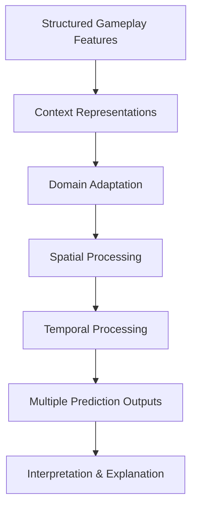
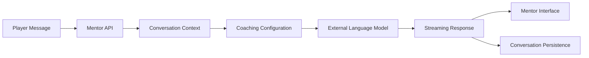
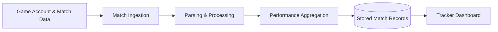

# Omni Coach — System Architecture

**Technical Architecture & Engineering Overview**

**Project:** Omni Coach  
**Category:** AI-Powered Competitive Gaming Intelligence  
**Development Status:** Active Development  
**Implementation:** Proprietary / Private Source Code

---

## 1. Architectural Overview

Omni Coach is an AI-assisted competitive gaming platform designed to transform gameplay data into structured analysis, personalized coaching, and longitudinal performance insights.

The system combines several engineering disciplines:

- Full-stack application development
- Game replay parsing and telemetry processing
- Asynchronous background job execution
- Custom machine-learning architecture and inference
- AI-assisted explanation generation
- Conversational mentoring
- Match-history synchronization and performance analytics
- Cloud-oriented deployment infrastructure

The platform is organized around three primary product workflows:

**Match Analysis** — Processes game replay data and generates analytical information and coaching explanations.

**AI Mentor** — Provides streaming conversational interactions with persistent session history.

**Performance Tracker** — Collects and aggregates available match information for historical performance analysis.

Counter-Strike 2 is the flagship game implementation. Additional game-related components remain under development or experimental evaluation.

This document describes the logical architecture supported by implementation review. It is not a verified production-deployment diagram.

---

## 2. High-Level System Architecture

The architecture separates interactive application requests from longer-running computational workflows.

Replay analysis, conversational mentoring, and match tracking have different processing requirements and are implemented as distinct responsibilities.

---

## 3. Frontend Architecture

### Technologies

- Astro
- React
- JavaScript / TypeScript
- CSS and Tailwind-related tooling
- Zustand for client-state management
- Blender-generated visual assets

The frontend contains both a marketing experience and application-facing interfaces.

### Application Interfaces

The inspected implementation includes interfaces for:

- Replay submission and analysis configuration
- Match telemetry and tactical replay presentation
- Post-match analytical dashboards
- Coaching reports
- Conversational AI mentoring
- Match tracking and performance history
- User-facing navigation and account interactions

### Marketing and Visual Systems

The marketing experience incorporates custom visual production and interaction techniques, including:

- Blender-based asset creation
- Rendered image sequences
- Scroll-controlled cinematic presentation
- Interactive product demonstrations
- Responsive interface behavior
- Reduced-motion accommodations
- Visibility-aware animation handling

These visual systems are separate from the actual gameplay-analysis engine.

The goal of this architectural separation is to allow the marketing experience to communicate the product's purpose while the application interfaces handle user workflows and analysis results.

---

## 4. Backend Application Layer

### Technologies

**Python · FastAPI · Pydantic · SQLAlchemy · PostgreSQL**

The backend provides application-facing services supporting uploads, analysis requests, conversational interactions, tracking, and related account operations.

### Primary Responsibilities

**Request processing**

The API provides structured entry points into application functionality.

**Analysis submission**

Replay-analysis requests enter an asynchronous processing workflow rather than requiring all computational work to finish inside the original HTTP request.

**Status management**

The application includes paths for analysis-job status retrieval and cancellation.

**Data persistence**

Database-oriented components manage application records, analysis state, and relevant user-facing data.

**Service integration**

The backend connects processing services, AI-related functionality, and application workflows.

The presence of these implementation paths does not independently establish current production availability or performance.

---

## 5. Asynchronous Analysis Infrastructure

Replay analysis can require substantially more computation than an ordinary application request.

Omni Coach addresses this through background-processing infrastructure.

### Simplified Execution Flow

### Engineering Features

The inspected queue implementation includes:

- Transactional database-backed work claiming
- PostgreSQL `SKIP LOCKED` coordination
- Job status and lifecycle handling
- Worker heartbeat mechanisms
- Stale-job recovery logic
- Separation of background execution from interactive requests

### Why This Matters

A long-running computation should not block ordinary application requests or depend on a single uninterrupted browser session.

Queue-based execution provides an architectural foundation for handling longer analysis tasks and coordinating multiple processing responsibilities.

**Validation boundary:** Controlled multi-worker execution, failure recovery, and production-scale throughput still require dedicated empirical verification.

---

## 6. Replay Processing & Telemetry

Game replay files contain structured events and state information that can be transformed into computational representations.

Omni Coach implements a replay-oriented processing workflow beginning with Counter-Strike 2.

### Processing Stages

### Technologies and Approaches

- Game-specific replay parsing
- `demoparser2`
- Structured numerical processing
- NumPy and Polars
- Tensor preparation
- Chunked and batched computational operations
- Integration with downstream model-processing components

### Design Considerations

Replay analysis requires translating game-specific data into representations suitable for analysis.

The architecture connects replay extraction, computational interpretation, and user-facing presentation.

The replay-analysis pipeline and match-tracker ingestion are separate systems and should not be considered interchangeable.

---

## 7. Custom Machine Learning Architecture

Omni Coach includes a custom neural-network subsystem implemented with PyTorch.

The inspected architecture combines multiple modeling components designed to represent structured gameplay information.

### Implemented Architectural Elements

- Game and map context embeddings
- Sparse mixture-of-experts input adaptation
- Spatial feature processing
- Attention-related representations
- Temporal processing components
- Multiple prediction heads
- Training-time dropout
- Gradient checkpointing
- Multi-objective training infrastructure

### Conceptual Model Flow

This diagram is intentionally conceptual and does not expose proprietary implementation specifics.

### Training Infrastructure

The repository contains custom training code involving multiple objectives, including prediction-related and future-state representation tasks.

### Model Validation

The existence of a custom architecture, training pipeline, and model checkpoint is evidence of implementation work—not proof of predictive quality.

Reliable model evaluation requires:

- Documented training and evaluation data
- Appropriate data separation
- Tests for data leakage
- Held-out performance measurements
- Calibration where probabilities are reported
- Reproducible evaluation procedures

These evaluation outcomes are not presented as independently verified in this document.

---

## 8. Attribution & AI Explanation

Omni Coach incorporates an explanation subsystem intended to connect structured model outputs with understandable coaching feedback.

### Key Components

**Gradient-based attribution**

Captum-based attribution techniques are used to help identify influential model input features.

**Specialist routing**

Relevant explanation responsibilities are selected according to the analysis context.

**Language-model synthesis**

External language-model integration supports converting structured analytical context into natural-language explanations.

**Alternative-action exploration**

The analysis architecture contains experimental mechanisms associated with comparing possible alternative states or actions.

### Important Scientific Distinction

Gradient-based attribution identifies features associated with model outputs. It does not independently establish that those features caused an observed gameplay result.

Likewise, model-based alternative actions are computational possibilities—not guarantees of different real-world outcomes.

Maintaining these distinctions is important when developing trustworthy analytical systems.

---

## 9. Conversational AI Mentor

The AI Mentor operates as a conversational application subsystem.

The inspected implementation includes:

- Conversation-session creation
- Message-history retrieval
- Persistent conversation records
- Conversation deletion
- Recent-context construction
- Configurable coaching personas
- Streaming response generation
- Frontend streaming integration
- Access and usage-related checks

### Logical Flow

The mentor is designed to support ongoing coaching conversations rather than isolated, one-time responses.

A marketing demonstration of a conversation must be distinguished from a verified live model interaction.

---

## 10. Performance Tracking Infrastructure

The tracking subsystem is responsible for ingesting and organizing available historical match information.

### Implemented Components

- Match acquisition and download paths
- Replay extraction and parsing
- Match-record processing
- Statistical aggregation
- Cached time-period profiles
- Match-history presentation
- Account connection and synchronization paths
- Additional comparison-related functionality

### Architecture

The term *live tracking* refers to the product's tracking and synchronization experience.

It should not be interpreted as verified real-time tactical assistance during active matches.

---

## 11. Data & Infrastructure

### Database

The implementation includes PostgreSQL-oriented persistence through SQLAlchemy and asynchronous database-access components.

Database infrastructure supports application state, processing records, analytical outputs, and relevant historical information.

### Storage

S3-compatible storage integrations support object-storage responsibilities associated with gameplay artifacts and application processing.

### Cloud and Deployment Configuration

The inspected workspace contains:

- Docker service definitions
- GitHub Actions workflows
- AWS-related deployment configuration
- RunPod worker deployment configuration
- Background-worker infrastructure
- Monitoring-related dependencies

These components demonstrate deployment-oriented engineering.

However, configuration files alone do not establish that every service is currently deployed, healthy, or operating at production scale.

---

## 12. Reliability & Testing

The project contains automated tests and development infrastructure covering multiple categories.

Examples include:

- Unit tests
- Integration-oriented tests
- Security-oriented tests
- End-to-end test infrastructure
- Load and performance-related testing code
- Frontend component tests
- Build and deployment workflows

### Verification Evidence

Previous development work recorded successful targeted frontend tests and builds.

Some backend tests use mocked external services and infrastructure components.

Mock-based testing is useful for verifying application orchestration, but it does not establish full real-world service reliability or model quality.

### Remaining Validation Priorities

- Full replay-to-report execution under controlled conditions
- Multi-worker queue coordination
- Recovery after interrupted jobs
- Authenticated mentor and tracker journeys
- Model evaluation on held-out data
- End-to-end latency and resource measurements
- Accessibility and cross-device verification
- Production deployment health checks

Reliability and performance claims should be based on measured results rather than test filenames, configuration values, or architectural intentions.

---

## 13. Major Engineering Decisions

### Separating Interactive and Computational Work

Background analysis is decoupled from ordinary application requests to accommodate potentially long-running replay processing.

### Separating Model Inference From External AI Calls

Compute-intensive tensor operations and network-dependent explanation generation have different performance characteristics.

The architecture includes separate handling for these responsibilities.

### Connecting Structured Data to Human Explanations

Replay analysis produces computational representations that can be interpreted and presented to users through analytical interfaces and natural-language coaching.

### Maintaining Distinct Processing Pipelines

Replay submission, persistent mentoring, and match-history tracking operate through different architectural paths suited to their responsibilities.

### Integrating Technical Systems With Product Design

The engineering challenge extends beyond model inference to include data ingestion, user workflows, persistence, responsive interfaces, and visual presentation.

---

## 14. Future Engineering Direction

Current development priorities include:

1. Completing repeatable end-to-end validation of the Counter-Strike 2 analysis pipeline.
2. Improving model evaluation and probability calibration.
3. Extending reliability testing across asynchronous workers and service boundaries.
4. Measuring processing latency, throughput, memory usage, and operational cost.
5. Improving coaching explanations and user-facing analytical clarity.
6. Refining accessibility, mobile responsiveness, and frontend performance.
7. Validating additional game integrations before describing them as supported products.

These are future priorities, not claims of completed functionality.

---

## 15. Project Scope & Source Availability

Omni Coach is an independently developed proprietary software project.

The full application source code, model weights, internal infrastructure details, operational data, and sensitive implementation artifacts remain private.

This document provides a high-level technical explanation intended for portfolio review, professional discussion, and demonstration of engineering approaches.

The architectural diagrams are conceptual representations of implemented responsibilities rather than disclosures of private deployment topology.

**This showcase is documentation-only and does not distribute the production application.**

---

**Bradley Harris**  
Independent Developer  
Omni Coach — Technical Architecture
